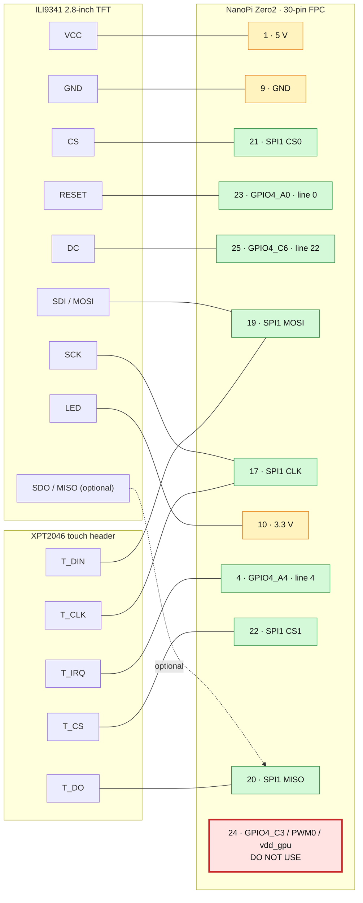

# NanoPi Zero2: SPI-дисплей ILI9341 и тачскрин XPT2046

Раздел содержит инструкции для NanoPi Zero2 / RK3528 с дисплеем
`2.8" TFT 240xRGBx320 V1.1`. Загрузочная схема зависит от выбранного образа,
поэтому инструкции разделены по системам.

Текущий рекомендуемый и наиболее полно проверенный маршрут — официальная
Ubuntu 24.04 FriendlyElec. Последние сквозные эксперименты, включая совместную
работу дисплея и XPT2046, автономный установочный скрипт и восстановление,
проводились именно на ней. Инструкция Armbian сохраняет результаты более
раннего рабочего эксперимента, но пока не считается окончательно оформленным и
полностью квалифицированным вариантом развёртывания.

Каталог самодостаточен: его можно скопировать или вынести в отдельный Git
repository целиком. Все локальные ссылки и команды разрешаются от корня этого
каталога и не требуют исходного дерева другого проекта.

## Выбрать инструкцию

| Система | Инструкция | Статус |
|---|---|---|
| Armbian Debian 13 | [`docs/armbian.md`](./docs/armbian.md) | Экспериментальный маршрут: SPI и экран были проверены на конкретном rolling-образе; актуальная сквозная квалификация и XPT2046 не завершены |
| Armbian Ubuntu | [`docs/armbian.md`](./docs/armbian.md) | Экспериментальный маршрут; нужен libgpiod v2 в venv, последние проверки на нём не повторялись |
| Официальная Ubuntu 24.04 FriendlyElec | [`docs/ubuntu.md`](./docs/ubuntu.md) | **Рекомендуемый маршрут:** дисплей и XPT2046 проверены вместе: `spidev1.0` + `ADS7846 Touchscreen` |
| Официальный Debian 13 FriendlyElec | [`docs/friendlyelec-vendor.md`](./docs/friendlyelec-vendor.md) | Исходники и сборочный маршрут проверены; аппаратный запуск не выполнен |

Armbian использует `/boot/armbianEnv.txt` и пользовательский `.dtbo`.
Официальные FriendlyElec-образы хранят DTB в `resource.img`. Эти способы нельзя
смешивать.

## Структура каталога

```text
.
├── .gitignore                         локальные Python/macOS артефакты
├── README.md                          точка входа и распиновка
├── docs/
│   ├── armbian.md                     установка и проверка Armbian
│   ├── ubuntu.md                      официальный Ubuntu Noble FriendlyElec
│   └── friendlyelec-vendor.md         vendor-схема и официальный Debian
├── overlays/
│   └── rk3528-spidev.dts              Armbian user overlay
├── patches/
│   ├── official-friendlyelec-spi1.patch
│   └── official-friendlyelec-spi1-touch.patch
└── scripts/
    ├── enable_spi1.sh                 автономная установка resource.img
    ├── test_ili9341.py                тест дисплея и UTF-8
    └── test_xpt2046.py                guided evdev-тест с мишенями
```

Все команды, содержащие локальные пути `scripts/`, `patches/` или `overlays/`,
выполняются из корня этого каталога. Для новой официальной FriendlyElec Ubuntu
основной маршрут выглядит так:

```bash
scp scripts/enable_spi1.sh pi@192.168.1.88:/home/pi/
ssh -t pi@192.168.1.88 \
  'sudo bash /home/pi/enable_spi1.sh --touch --install --reboot'
```

Перед `--touch` дисплей и touch header должны быть подключены по приведённой
ниже схеме. Display-only установка использует ту же команду без `--touch`.
Полные проверки, recovery и различия образов описаны в
[`docs/ubuntu.md`](./docs/ubuntu.md).

## Критическое предупреждение

**Не использовать `/dev/gpiochip4` линии 19, 20 и 21.** Это GPIO4_C3/C4/C5.
В официальном FriendlyElec DTS они заняты PWM-регуляторами `vdd_gpu`,
`vdd_cpu` и `vdd_logic`. GPIO4_C3 выведен на FPC24, но запрос линии 19 породил
kernel warning и переключил управляющий питанием GPU пин из PWM в GPIO.
Запрос линий 20/21 полностью останавливал NanoPi: замирал heartbeat LED,
пропадали SSH и UART.

Безопасные линии управления дисплеем:

```text
RESET = FPC 23 = GPIO4_A0 = gpiochip4 line 0
DC    = FPC 25 = GPIO4_C6 = gpiochip4 line 22
```

Все сигнальные линии имеют уровень 3.3 V. Переставлять провода следует только
при отключённом питании.

## Рабочая распиновка дисплея

Одна и та же схема используется в Armbian и официальной FriendlyElec Ubuntu:



Нумерация FPC соответствует схеме FriendlyElec. Провода переставлять только при
полностью отключённом питании.

| Дисплей | FPC NanoPi | Назначение |
|---|---:|---|
| `VCC` | 1 | 5 V; также доступны FPC 2 и 3 |
| `GND` | 9 | GND; также 16, 18, 26, 28 и 30 |
| `CS` | 21 | SPI1 CS0 / GPIO1_C1 |
| `RESET` | 23 | GPIO4_A0, gpiochip4 line 0 |
| `DC` | 25 | GPIO4_C6, gpiochip4 line 22 |
| `SDI (MOSI)` | 19 | SPI1 MOSI / GPIO1_B7 |
| `SCK` | 17 | SPI1 CLK / GPIO1_B6 |
| `LED` | 10 | 3.3 V; также доступен FPC 11 |
| `SDO (MISO)` | 20 | SPI1 MISO / GPIO1_C0; для вывода необязателен |

Тачскрин использует ту же SPI-шину и отдельный CS1. `CLK` и `MOSI` нужно
разветвить на дисплей и пятиштырьковый touch header:

| Touch header | FPC NanoPi | Назначение |
|---|---:|---|
| `T_CLK` | 17 | SPI1 CLK |
| `T_CS` | 22 | SPI1 CS1 / GPIO1_C2 |
| `T_DIN` | 19 | SPI1 MOSI |
| `T_DO` | 20 | SPI1 MISO |
| `T_IRQ` | 4 | GPIO4_A4, gpiochip4 line 4, active low |

`SDO/MISO` самого дисплея оставлять отключённым: FPC20 нужен `T_DO`, а вывод
кадра идёт только по TX. Совместная работа проверена на Ubuntu: дисплей на
SPI1 CS0 (`/dev/spidev1.0`), XPT2046 на CS1 через `ads7846`, IRQ на FPC4.

## Полная распиновка 30-pin FPC

| FPC | Сигнал | FPC | Сигнал |
|---:|---|---:|---|
| 1 | 5 V | 16 | GND |
| 2 | 5 V | 17 | GPIO1_B6 / SPI1 CLK |
| 3 | 5 V | 18 | GND |
| 4 | GPIO4_A4 | 19 | GPIO1_B7 / SPI1 MOSI |
| 5 | GPIO4_A5 | 20 | GPIO1_C0 / SPI1 MISO |
| 6 | GPIO4_A6 | 21 | GPIO1_C1 / SPI1 CS0 |
| 7 | GPIO4_A7 | 22 | GPIO1_C2 / SPI1 CS1 |
| 8 | GPIO4_B4 | 23 | GPIO4_A0 |
| 9 | GND | 24 | GPIO4_C3 / PWM0 / `vdd_gpu`; не использовать как GPIO |
| 10 | 3.3 V | 25 | GPIO4_C6 |
| 11 | 3.3 V | 26 | GND |
| 12 | GPIO1_B2 | 27 | AOL, аналоговый аудиовыход |
| 13 | GPIO1_B3 | 28 | GND |
| 14 | GPIO1_B4 | 29 | AOR, аналоговый аудиовыход |
| 15 | GPIO1_B5 | 30 | GND |

## Общий тест ILI9341

[`scripts/test_ili9341.py`](./scripts/test_ili9341.py) поддерживает:

- полный ILI9341 init и RGB565;
- тестовую таблицу и UTF-8 текст через Pillow;
- `--gpiochip`, `--dc` и `--reset`;
- выбор Linux SPI устройства через `--bus` и `--device`;
- частоту и поворот изображения.

Armbian создал `/dev/spidev0.0`, поэтому используются значения по умолчанию.
Vendor kernel FriendlyElec содержит SPI aliases и ожидаемо создаёт
`/dev/spidev1.0`, для него передаётся `--bus 1`.

Framebuffer отправляется через `writebytes2()`. Не заменять его на `xfer2()`:
отрисовка требует только TX, а лишний RX приводил к нестабильности RK3528 SPI.

## Guided-тест XPT2046

[`scripts/test_xpt2046.py`](./scripts/test_xpt2046.py) работает через стандартное Linux input
устройство `ADS7846 Touchscreen`, автоматически находит его `/dev/input/eventX`
и последовательно подсвечивает пять точек на ILI9341. После каждого полного
нажатия мишень становится зелёной. Скрипт не открывает CS1 напрямую, поэтому
одновременно проверяет дисплей на CS0, kernel-драйвер, IRQ, координаты и
давление.

Проверенный портретный профиль Ubuntu выдаёт X `0..3550`, Y `350..3650`,
pressure `0..2000`; X инвертирован ровно один раз в Device Tree. В физическом
пяти-точечном прогоне с точным нажатием максимальная ошибка линейной проекции
составила `2.1 px`. Это диагностическая калибровка конкретного модуля; UI
должен либо применять полученную evdev-проекцию, либо использовать калибровку
своего input стека, но не обе сразу.

## Контроль целостности

```text
scripts/enable_spi1.sh
f3bdede5a29edd32d8e9e8828910ac37cd995b855fb6901190ae32fcb37223b6

scripts/test_ili9341.py с безопасным RESET на FPC23 и параметрами --bus/--device
42b48674a79dac60e5c7c70867dfa5d988cee74cb582676dfd7cbd720b378096

patches/official-friendlyelec-spi1.patch
67285345a1b3226757aac14abab617478d95247d022c7496601162cee446016e

scripts/test_xpt2046.py с auto-detect evdev и экранными мишенями
152ffefde7f094bd63e934d4929fe02ce06534be6d5cbb4461c1fd846998300a

patches/official-friendlyelec-spi1-touch.patch
77c957b332cfb032aa88012a2c55f705bcc05c31d2e25370bc9d290dce132db6
```

## Аппаратная документация

- [FriendlyELEC NanoPi Zero2 Wiki](https://wiki.friendlyelec.com/wiki/index.php/NanoPi_Zero2)
- [Схема NanoPi Zero2](https://wiki.friendlyelec.com/wiki/images/3/37/NanoPi_Zero2_2407_SCH.pdf)
