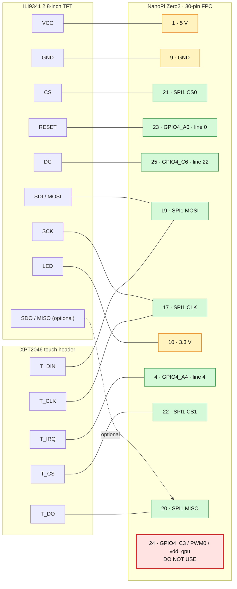

# Аппаратные интерфейсы NanoPi Zero2

## Критическое предупреждение

**Не использовать `/dev/gpiochip4` линии 19, 20 и 21.** Это GPIO4_C3/C4/C5.
В официальном FriendlyElec DTS они заняты PWM-регуляторами `vdd_gpu`,
`vdd_cpu` и `vdd_logic`. GPIO4_C3 выведен на FPC24, но запрос линии 19 породил
kernel warning и переключил управляющий питанием GPU пин из PWM в GPIO.
Запрос линий 20/21 полностью останавливал NanoPi: замирал heartbeat LED,
пропадали SSH и UART.

Безопасные линии управления дисплеем:

```text
RESET = FPC 23 = GPIO4_A0 = gpiochip4 line 0
DC    = FPC 25 = GPIO4_C6 = gpiochip4 line 22
```

Все сигнальные линии имеют уровень 3.3 V. Переставлять провода следует только
при отключённом питании.

## Рабочая распиновка дисплея

Одна и та же схема используется в Armbian и официальной FriendlyElec Ubuntu:



Нумерация FPC соответствует схеме FriendlyElec. Провода переставлять только при
полностью отключённом питании.

| Дисплей | FPC NanoPi | Назначение |
|---|---:|---|
| `VCC` | 1 | 5 V; также доступны FPC 2 и 3 |
| `GND` | 9 | GND; также 16, 18, 26, 28 и 30 |
| `CS` | 21 | SPI1 CS0 / GPIO1_C1 |
| `RESET` | 23 | GPIO4_A0, gpiochip4 line 0 |
| `DC` | 25 | GPIO4_C6, gpiochip4 line 22 |
| `SDI (MOSI)` | 19 | SPI1 MOSI / GPIO1_B7 |
| `SCK` | 17 | SPI1 CLK / GPIO1_B6 |
| `LED` | 10 | 3.3 V; также доступен FPC 11 |
| `SDO (MISO)` | 20 | SPI1 MISO / GPIO1_C0; для вывода необязателен |

Тачскрин использует ту же SPI-шину и отдельный CS1. `CLK` и `MOSI` нужно
разветвить на дисплей и пятиштырьковый touch header:

| Touch header | FPC NanoPi | Назначение |
|---|---:|---|
| `T_CLK` | 17 | SPI1 CLK |
| `T_CS` | 22 | SPI1 CS1 / GPIO1_C2 |
| `T_DIN` | 19 | SPI1 MOSI |
| `T_DO` | 20 | SPI1 MISO |
| `T_IRQ` | 4 | GPIO4_A4, gpiochip4 line 4, active low |

`SDO/MISO` самого дисплея оставлять отключённым: FPC20 нужен `T_DO`, а вывод
кадра идёт только по TX. Совместная работа проверена на Ubuntu: дисплей на
SPI1 CS0 (`/dev/spidev1.0`), XPT2046 на CS1 через `ads7846`, IRQ на FPC4.

## Полная распиновка 30-pin FPC

| FPC | Сигнал | FPC | Сигнал |
|---:|---|---:|---|
| 1 | 5 V | 16 | GND |
| 2 | 5 V | 17 | GPIO1_B6 / SPI1 CLK |
| 3 | 5 V | 18 | GND |
| 4 | GPIO4_A4 | 19 | GPIO1_B7 / SPI1 MOSI |
| 5 | GPIO4_A5 | 20 | GPIO1_C0 / SPI1 MISO |
| 6 | GPIO4_A6 | 21 | GPIO1_C1 / SPI1 CS0 |
| 7 | GPIO4_A7 | 22 | GPIO1_C2 / SPI1 CS1 |
| 8 | GPIO4_B4 | 23 | GPIO4_A0 |
| 9 | GND | 24 | GPIO4_C3 / PWM0 / `vdd_gpu`; не использовать как GPIO |
| 10 | 3.3 V | 25 | GPIO4_C6 |
| 11 | 3.3 V | 26 | GND |
| 12 | GPIO1_B2 | 27 | AOL, аналоговый аудиовыход |
| 13 | GPIO1_B3 | 28 | GND |
| 14 | GPIO1_B4 | 29 | AOR, аналоговый аудиовыход |
| 15 | GPIO1_B5 | 30 | GND |

## UART

Отладочный UART проверен на `1500000 baud, 8N1`. Подключение терминала и
восстановление описаны в [диагностике](../guides/troubleshooting.md).

## Источники и результаты

- [Каталог FriendlyElec](../vendor/README.md): wiki и схема NanoPi Zero2.
- [Проверенные конфигурации](validation/README.md): ОС, ядра и границы проверки.
